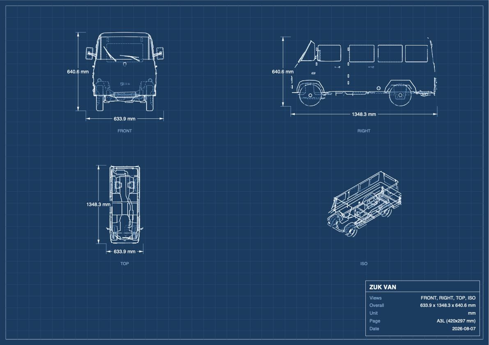
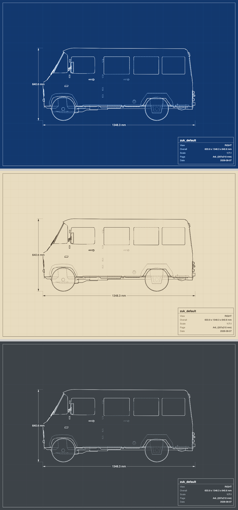

# blueprint-tool

3D model in → dimensions + orthographic blueprint drawings out. Runs on Blender, no other
dependencies. Two front ends over one implementation:

- **Blender add-on** — a panel in the 3D viewport sidebar. Same on macOS and Windows.
- **Command line** — for batching, or driving it from another script.

Both call `blueprint_tool/core.py`, so they cannot drift apart.



*Four views on one A3 plate, cyanotype theme with the graticule on.*

## Install the add-on

One command — it finds Blender, builds the zip, installs it, enables it, and confirms it
survived into a fresh Blender session:

```bash
python3 install_addon.py
```

Or double-click **Install on macOS.command** / **Install on Windows.bat**. Add
`--uninstall` to remove it, `--list` to see which Blender installs were found, or set
`BLENDER=/path/to/blender` to choose one.

To install by hand instead: `python3 build_addon.py`, then in Blender
**Edit ▸ Preferences ▸ Add-ons ▸ ▾ ▸ Install from Disk…** and pick the zip from `dist/`.

Open the panel with **N** in the 3D viewport, then the **Blueprint** tab.

### Using it

1. Leave **Use Current Scene** ticked to draw what is already open — or untick it, pick a
   file, and press **Import Model**.
2. Set **Output** (defaults to a `blueprints/` folder beside the .blend), and a **Title**
   for the title block.
3. Choose views — **Std** is front/right/top/iso, **All** is all seven.
4. Set unit, page size, theme and layout, then **Generate**.

The **Dimensions** sub-panel picks what gets measured, and **Preview** draws the result
live over the viewport.

The add-on saves and restores everything it touches — your camera, frame range, render
engine, resolution and viewport shading all come back as they were, and the temporary
cameras and Line Art object are deleted. It will not disturb the scene you are working in.

## Themes and layout

Six paper themes: `white`, `blueprint`, `cyanotype`, `sepia`, `steel`, `dark`. `--grid`
adds the faint graticule of real blueprint paper.



Two layouts. `sheet` (default) gives one page per view. `--plate` lays every view out on a
single sheet, poster style, with one shared title block — the grid is chosen so the cells
match the page proportions rather than leaving a hole.

```bash
./bp car.fbx --plate --theme cyanotype --grid --page a3l --pdf --title "MY CAR"
```

## Dimensions

Dimension sources are independent and combine freely:

| Source | Flag | What it measures |
|---|---|---|
| Overall | on by default | the model's extents in each view |
| Selected objects | `--dim-objects` | each object's bounding box |
| Selected edges | `--dim-edges` | length of every selected edge; two edges also give the angle between them; a selected circular loop gives its diameter |
| Auto circles | `--dim-auto` | circular features found automatically, as diameter or `--radius` |
| Empties | `--dim-empties` | between Empties, paired in name order |

Kinds: `linear`, `length`, `diameter`, `radius`, `angle` — restrict with
`--kinds diameter,angle`.

Edge selection is read live in Edit Mode, and from the stored selection otherwise.
Placement keeps every label as a rectangle and pushes each new one further out until it
stops overlapping anything already placed, dimension lines included; a dimension that
cannot find a clear spot is dropped rather than drawn over something else.

## Command line

```bash
./bp model.fbx --out ./out --views front,right,top,iso --unit mm --page a3l --hidden
```

`bp` is a thin wrapper; the real invocation is:

```bash
blender -b --python cli.py -- --input model.fbx --out ./out --unit mm
```

Override the binary with `BLENDER=/path/to/blender ./bp …`, and see full Blender output
with `VERBOSE=1 ./bp …`. On Windows, call `blender.exe -b --python cli.py -- …` directly.

Accepts `.fbx .blend .obj .glb .gltf .stl .ply .usd*`.

## Output

| File | What |
|---|---|
| `dimensions.json` | overall and per-object dimensions, units, and the exact world→pixel mapping per view |
| `<view>.svg` | print-scaled vector drawing: hidden-line-removed linework, dimensions, title block |
| `<view>.png` | optional shaded reference render |
| `plate.svg` | with `--plate`: every view on one sheet |
| `blueprints.pdf` | with `--pdf`: one multi-page document |

Views: `front back left right top bottom iso`. The `iso` view is pictorial — it gets no
dimension annotations.

See [`examples/`](examples/) for real output.

## Options

| CLI flag | Panel | Default | Notes |
|---|---|---|---|
| `--unit` | Unit | `m` / `mm` | `m cm mm in ft` |
| `--page` | Page | `a4l` / `a3l` | `a4l a4p a3l a3p a2l` — sets physical page size and resolution (300 dpi) |
| `--margin` | Margin | `0.18` | fraction of the page kept clear for dimensions and title block |
| `--crease` | Crease | `140` | degrees; edges whose faces meet BELOW this become lines, so HIGHER draws more detail |
| `--hidden` | Hidden | off / on | occluded edges as dashed lines; roughly doubles generation time |
| `--no-dims` | Dims | on | dimension lines and values |
| `--png` | PNG | off | shaded reference image per view |
| `--title` | Title | filename | title block heading |

## How it works

1. Import, then measure world axis-aligned bounding boxes, overall and per object.
2. Per view, build an orthographic camera framed on the bbox. `sensor_fit=HORIZONTAL`
   fixes `ortho_scale` to mean "world units across the image width" whatever the aspect.
3. A Grease Pencil **Line Art** modifier produces the linework. At occlusion level 0 this
   is true hidden-line removal, not just edge extraction.
4. Read the baked strokes, project each point with `world_to_camera_view`, and write the
   SVG here rather than using Blender's exporter (see below).

Because the projection is ours, `dimensions.json.views.<view>` carries everything needed
to place further annotations without re-deriving anything:

```
x_px = world_to_camera_view(scene, cam, P).x * res_x
y_px = (1 - world_to_camera_view(scene, cam, P).y) * res_y
```

## Layout

```
blueprint_tool/__init__.py   add-on: properties, operators, panels
blueprint_tool/core.py       scene loading, measuring, cameras, Line Art, orchestration
blueprint_tool/render.py     Sheet primitives, themes, SVG and PDF backends
blueprint_tool/annotate.py   dimension extraction and collision-aware placement
blueprint_tool/preview.py    viewport GPU overlay
cli.py                       command-line entry point
bp                           shell wrapper around cli.py
build_addon.py               zips blueprint_tool/ into dist/
install_addon.py             finds Blender, builds, installs, enables, verifies
```

A drawing is built once as a `Sheet` — an ordered list of primitives in page-pixel space —
and then written by a backend. SVG, PDF and the viewport overlay all consume the same
Sheet, so they cannot disagree about what the drawing contains. The PDF is emitted
directly: Blender ships no PDF writer and reportlab is not available inside it, but a PDF
of vector paths and base-14 text is small enough to write by hand.

`build_addon.py` reads the version straight out of `bl_info`, so the zip name cannot drift
from the add-on. After pulling changes, rebuild and reinstall — Blender copies the add-on
into its own scripts folder, so the installed copy is a snapshot, not a live link.

## Blender 5.0 notes (found the hard way)

- **`wm.grease_pencil_export_svg` is unusable in 5.0.** It emits degenerate coordinates —
  stroke points collapse to a single value around `1e25`, with a `0 0 0 0` viewBox, on
  every combination of bake/live and clip-camera. Hence the local SVG writer.
- **`lineart_bake_strokes` bakes the whole scene frame range.** A 250-frame source file
  bakes 250 times per view. Pin `frame_start = frame_end = frame_current = 1` first —
  drops a bake from ~2.5 s to ~0.04 s.
- **A bake leaves an empty keyframe at frame 0** next to the real one, so
  `layer.frames[0]` is the wrong frame and yields zero strokes. Select by
  `frame_number == scene.frame_current`.
- **`cam.matrix_world` is stale until the depsgraph runs.** The `iso` view derives its
  axes from that matrix; reading it straight after setting `rotation_euler` gives the
  identity matrix and an empty drawing. Call `bpy.context.view_layer.update()` first.
- **Workbench `light='FLAT'` + white `single_color` on a white world renders white on
  white** — a 100% blank PNG that looks like a failed render.
- **Line Art draws no contour for a smooth curved surface.** A plain cylinder comes out as
  two cap rings with nothing joining them, because its side edges meet at ~169 degrees and
  so are not creases; raising the crease threshold far enough to catch them turns the
  cylinder into a striped barrel instead. This tool computes silhouette edges itself and
  hands them to Line Art as Freestyle edge marks, so they are still occlusion-tested.
- **`crease_threshold` runs the opposite way to intuition:** faces meeting BELOW the
  threshold are creases, so a HIGHER value draws more lines, not fewer.
- **Freestyle edge marks are a generic attribute in 5.0** — a BOOLEAN on the EDGE domain
  named `freestyle_edge`. `MeshEdge.use_freestyle_mark` no longer exists.
- **`bpy.ops.preferences.addon_remove` cannot run headless** — it ends with
  `context.area.tag_redraw()` and `context.area` is None in background mode, so it raises
  *after* deleting the files, leaving preferences pointing at an add-on that is gone.
- GPv3 stores strokes as flat point attributes plus `curve_offsets`, not `stroke.points`.
- Modifier property names: `use_material` (not `use_material_boundary`), `radius` (not
  `thickness`).
- `FloatProperty(subtype="ANGLE_LENGTH")` is not valid and fails registration; `ANGLE`
  stores radians, so plain degrees is simpler for a threshold like the crease angle.

## Accuracy

FBX unit handling is correct: the same model exported to FBX with `apply_unit_scale` both
on and off imports back to the same size, matching the source `.blend` exactly
(`633.9 × 1348.3 × 640.6 mm`). Blender's 4.5+ C++ FBX importer applies the file's
`UnitScaleFactor` — three.js `FBXLoader` does not, which is the usual source of
100× dimension errors in browser-based tools.

Caveats, also emitted into `dimensions.json`:

- Dimensions are **axis-aligned** bounding boxes. A part rotated off-axis reports a larger
  box than its true size — use that object's `local_dimensions` instead.
- Line Art follows the mesh, so a tessellated curve reads as facets.
- The stated scale assumes the SVG is printed at its declared physical page size.

## License

MIT — see [LICENSE](LICENSE).

Blender itself is GPL, but this is a script *run by* Blender rather than a derivative of
it, and its output is your own data. Nothing here redistributes Blender.
